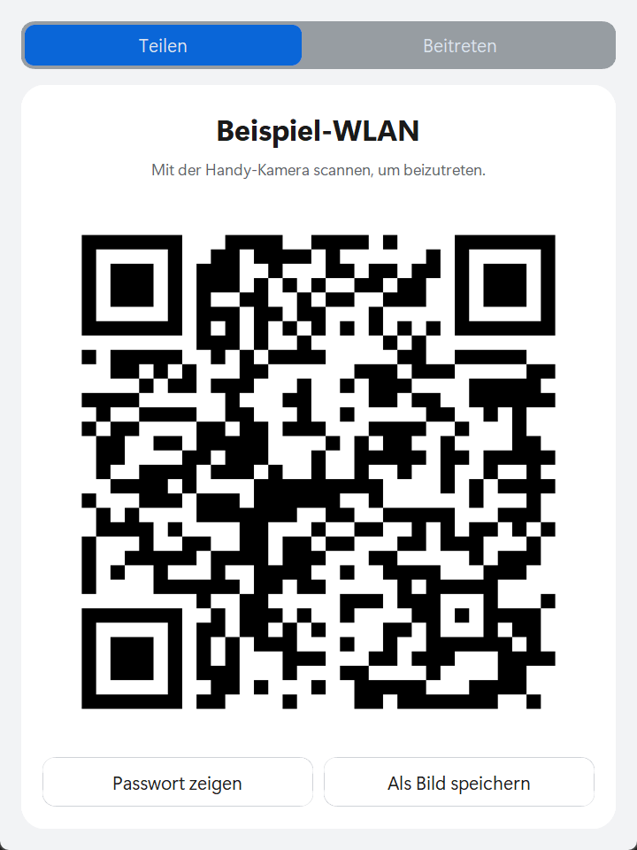
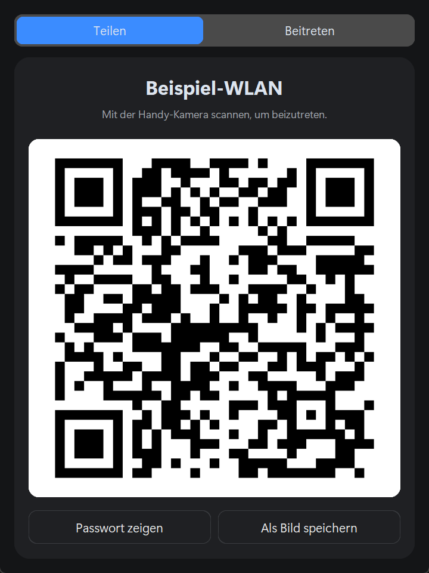

<p align="center"></p>

<h1 align="center">WLAN-QR</h1>

<p align="center">Kleines Windows-Programm: WLAN per QR-Code teilen und per Webcam einem WLAN beitreten.<br>
<em>Small Windows tool: share your Wi-Fi as a QR code and join a Wi-Fi network by scanning a QR code with your webcam.</em></p>

<p align="center">
  
  
</p>

## Was es kann

- **Teilen:** Zeigt das WLAN, mit dem der PC gerade verbunden ist, als QR-Code. Handy-Kamera drauf, fertig.
- **Passwort zeigen** auf Knopfdruck (sonst versteckt) und **QR-Code als Bild speichern**.
- **Beitreten:** Webcam einschalten, WLAN-QR-Code davorhalten, auf „Verbinden“ klicken.
- Fenster lässt sich frei skalieren. Hell- und Dunkelmodus folgen der Windows-Einstellung.
- Keine Adminrechte nötig. Nichts wird ins Internet geschickt.

## Installation

Voraussetzung: Windows 10/11 und [Python 3.10+](https://www.python.org/downloads/).

```powershell
git clone https://github.com/maximilianfrank64-crypto/wlan-qr.git
cd wlan-qr
python -m pip install -r requirements.txt
```

Starten: Doppelklick auf `WLAN-QR starten.bat` (oder `python wlan_qr.py`).

## Wie es funktioniert

- Das Passwort kommt aus dem gespeicherten Windows-WLAN-Profil (`netsh wlan export profile key=clear`).
- Der QR-Code hat das Standardformat `WIFI:T:WPA;S:<Name>;P:<Passwort>;;`, das iPhone und Android direkt verstehen.
- Beim Beitreten legt das Programm ein WLAN-Profil an (`netsh wlan add profile`) und verbindet sich. Es probiert WPA2, dann WPA3, dann WPA.

## English

Windows only. Install with `pip install -r requirements.txt`, run `python wlan_qr.py`.
**Share** shows the current Wi-Fi as a QR code, **Join** reads a Wi-Fi QR code from the webcam and connects.
The UI is in German. Add `--demo` to show a sample network instead of your real one.

## Lizenz

MIT
